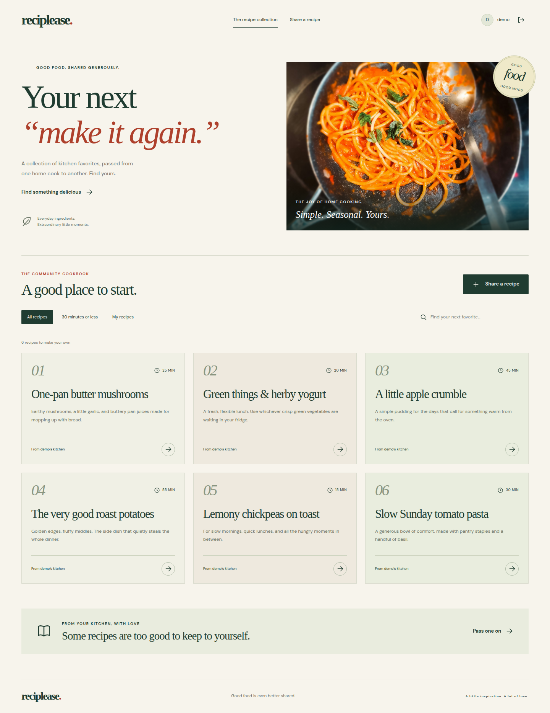

# Reciplease

A community cookbook built with React, Tailwind CSS, and a Flask API. Create an account, discover recipes, and share your own with a live Markdown preview.



## Local preview

The frontend runs at **http://localhost:4000** and proxies API requests to **http://localhost:5555**.

### Install and prepare

From the repository root, using Python 3.8+ and Node.js:

```bash
python3 -m venv .venv
.venv/bin/pip install -r server/requirements.txt
npm ci --prefix client
cd server
../.venv/bin/flask --app app db upgrade
../.venv/bin/python seed.py
```

The seed is repeatable and adds six sample recipes without deleting existing data. For the local demo, choose **Explore the demo kitchen**, or log in with username `demo` and password `reciplease-demo`. New accounts can also be created in the interface.

### Start the API

From `server/`:

```bash
../.venv/bin/flask --app app run --port 5555
```

### Start React

In a second terminal, from the repository root:

```bash
npm start --prefix client
```

Open http://localhost:4000. To suppress opening a browser automatically, run `BROWSER=none npm start --prefix client`. Use the default host: this version of Create React App can reject an explicit `HOST=127.0.0.1` when a proxy is configured.

## Features

- Signup, password confirmation, login, logout, and cookie-based session restoration.
- Bcrypt password hashing; password hashes are excluded from every response.
- Authenticated recipe collection with title, instruction, and author search.
- Filters for your own recipes and recipes taking 30 minutes or less.
- Recipe detail pages and Markdown rendering.
- Recipe creation with a live preview and server-side validation. Recipe ownership always comes from the authenticated session.
- Responsive layouts, visible field labels, keyboard focus styles, reduced-motion support, and loading/error/empty states.
- SQLite database migrations and a non-destructive, repeatable demo seed.

## Checks

From the repository root:

```bash
.venv/bin/pytest -q --disable-warnings
npm run build --prefix client
```

Tests use a temporary isolated SQLite database; they do not delete the preview's recipes. The suite includes the original 19 curriculum tests and 12 additional API/security cases.

The interface was also checked with automated headless Chrome at widths of 1440, 768, and 390 pixels. The checked flows include signup, validation, login, logout, refresh persistence, recipe details, search, filters, live preview, and saving a recipe. See [verification notes](VERIFICATION.md).

## API

| Method | Route | Purpose |
| --- | --- | --- |
| POST | `/signup` | Create an account and start a session |
| GET | `/check_session` | Restore the signed-in user |
| POST | `/login` | Authenticate and start a session |
| DELETE | `/logout` | Clear the session |
| GET | `/recipes` | Read the community cookbook; requires a session |
| POST | `/recipes` | Create a recipe owned by the signed-in user |

Validation errors return HTTP 422 with an `errors` array. Unauthenticated requests return HTTP 401. Instructions must contain at least 50 characters; cooking time must be a positive whole number.

## Configuration and deployment notes

The default database is `server/instance/app.db`. Set `DATABASE_URL` to use a different SQLAlchemy database URL. Set a stable, private `SECRET_KEY` before deploying so sessions survive process restarts and work across workers. Without one, development uses a random key each time the server starts.

This is a completed local educational project, not a hardened production deployment. Use a production WSGI server, HTTPS, secure session cookies, rate limiting, and a stable secret for public hosting. Do not seed the public demo credentials into a real production database. The inherited React 17 / Create React App 5 toolchain has known dependency audit findings; modernization should be reviewed separately before a production release.

## Design and assets

The interface follows a warm editorial cookbook concept. See [DESIGN.md](DESIGN.md) for palette, references, image provenance, and licensing. The locally stored pasta photo is by Zoshua Colah on Unsplash, used under the [Unsplash License](https://unsplash.com/license). No AI-generated imagery is used.

This project completes the [Learn.co Flask IAM lab](https://github.com/learn-co-curriculum/flask-iam-putting-it-all-together-lab). Original licensing is retained in [LICENSE.md](LICENSE.md).
